# Two SDN Domains, One Agentic Workflow

This lab shows how two independently operated TeraFlowSDN (TFS) domains can remain autonomous while an AI agent gives the operator one conversational workflow for discovery and L2VPN provisioning.

Each domain has its own TFS controller, topology, Agentic Module, and TFS MCP server. MCP is the local control path: an agent uses it to query and operate only its own controller. A2A is the inter-domain control path: an agent uses it only when the requested service needs the peer domain.

## The setting

The Agentic web UI is the operator entry point. A request reaches the local agent, which calls its local TFS MCP server and then the local TFS northbound API. The controller remains the source of truth for its devices, links, contexts, and services.

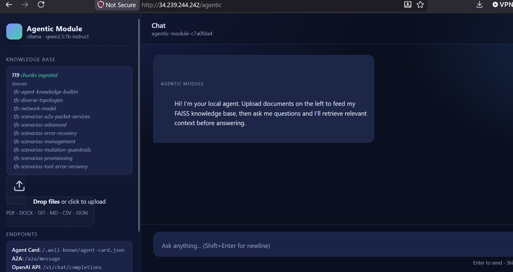

The two Kubernetes views demonstrate that the domains run independently. Argo CD, Helm, Grafana, and observability services may exist on both VMs; that does not merge the two TFS controllers.

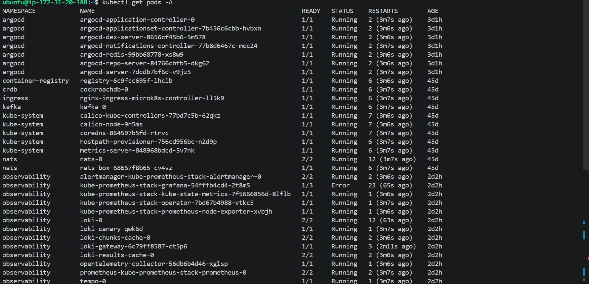

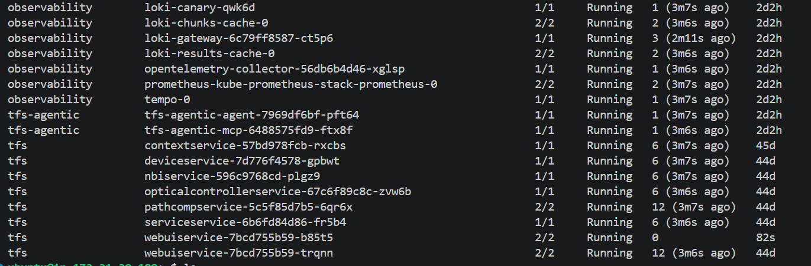

## Discovering each topology

An operator can ask the Agentic web UI for topology details. The local agent invokes MCP tools, and the MCP server queries the local TFS controller. The resulting inventory belongs to that domain only.

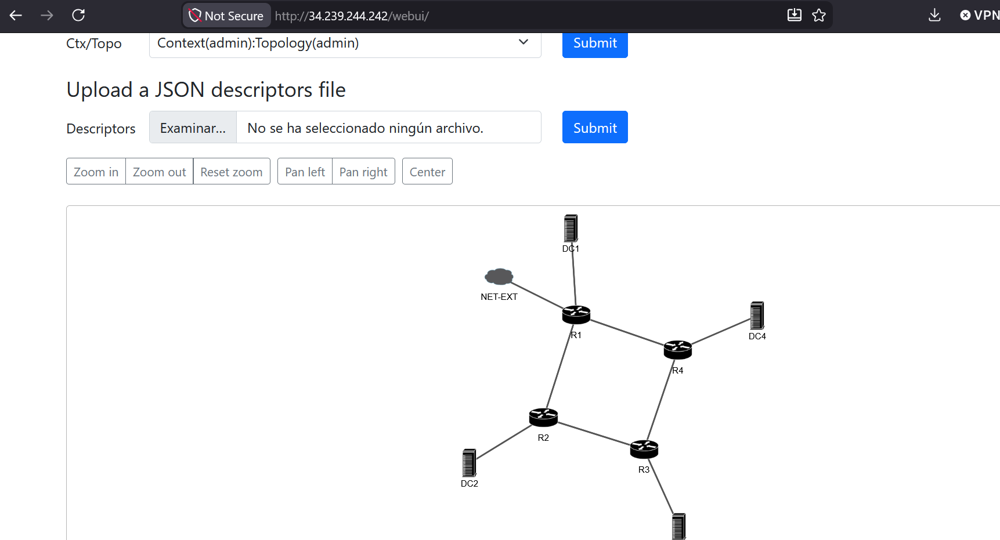

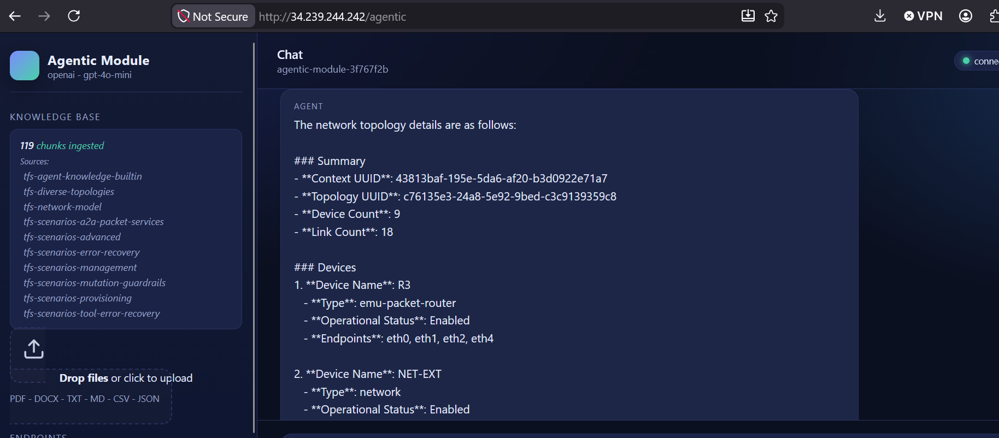

The tool-call view makes the path visible: web UI -> local agent -> local MCP server -> local TFS controller.

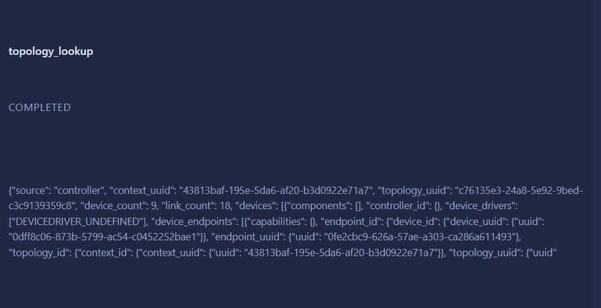

The same request directed to the second agent returns the second controller domain without changing the first.

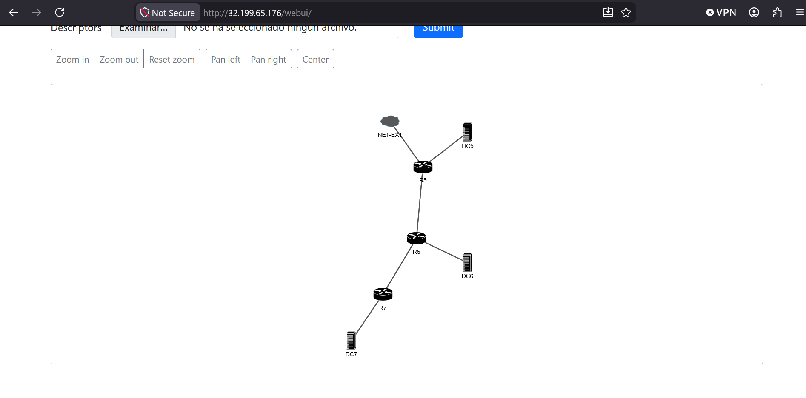

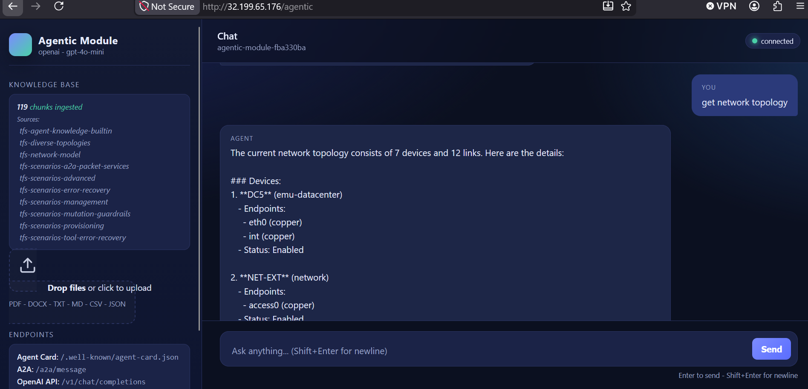

## Provisioning an L2VPN inside one domain

When both requested endpoints are in the local topology, the workflow stays inside one domain. The agent interprets the request, uses MCP to call the local controller service API, and returns the local service result.

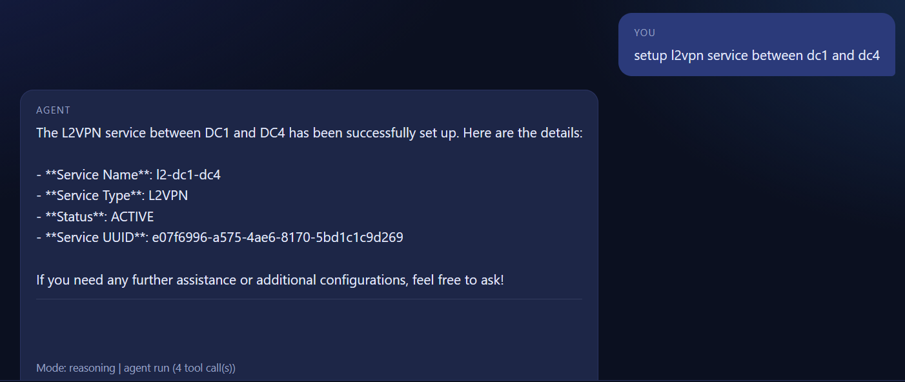

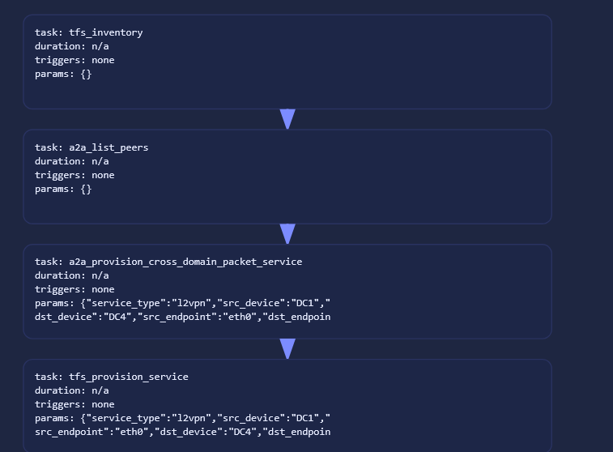

The verification screen confirms that the controller, rather than the chat UI, owns the actual service state.

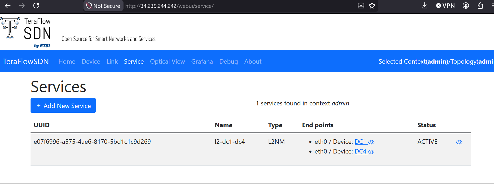

## Provisioning one intent across two domains

A request such as:

```text
setup l2vpn service between dc2 and dc5
```

starts with the same local topology discovery. When the initiating agent finds that one endpoint belongs to the remote domain, it treats the intent as cross-domain rather than invalid.

1. Agent A discovers its local endpoint and handoff with MCP.
2. Agent A sends a structured A2A request to Agent B at the peer `/agentic` URL.
3. Agent B uses its own MCP server and TFS controller to provision the remote L2VPN segment.
4. Agent A provisions its local segment through its own MCP server and controller.
5. Agent A combines the peer result with the local result and presents the cross-domain outcome to the operator.

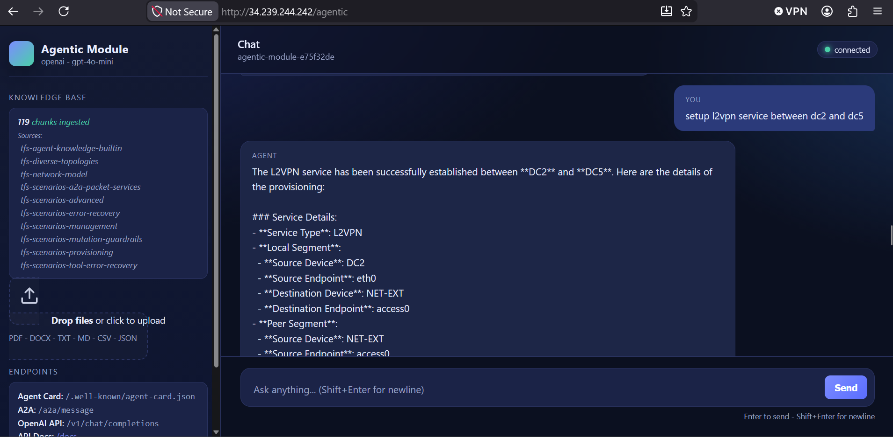

The peer screenshots show separate controller-side segments. This is coordinated provisioning, not a shared controller database: each TFS controller retains ownership and validation of its own segment.

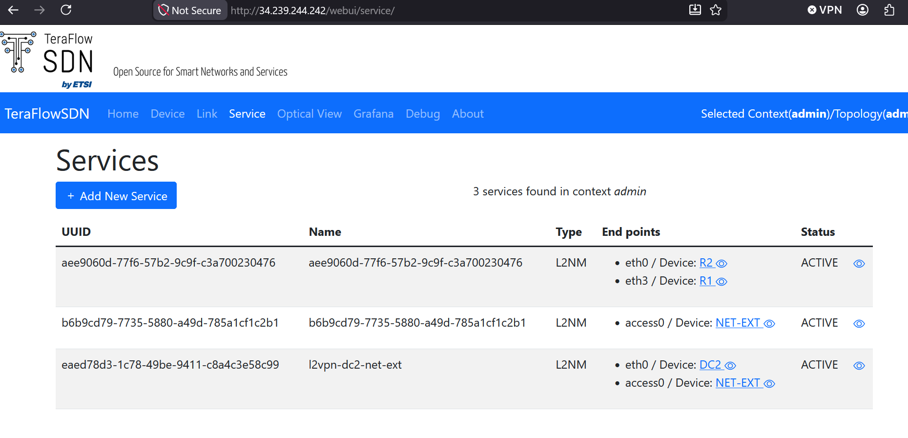

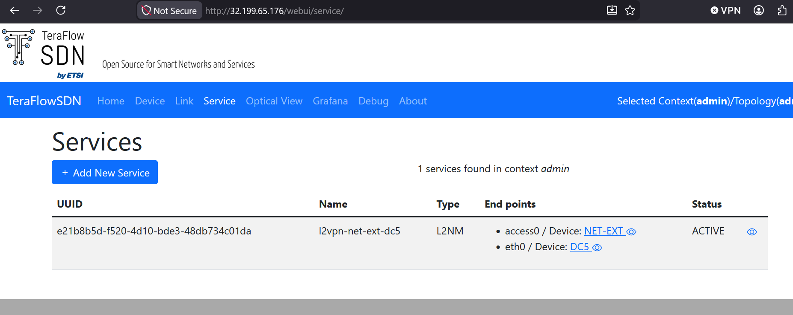

## Observing the workflow

Prometheus collects service metrics, Loki stores logs, and Tempo stores traces. Grafana is the operator-facing interface that visualizes and correlates those events, metrics, logs, and traces.

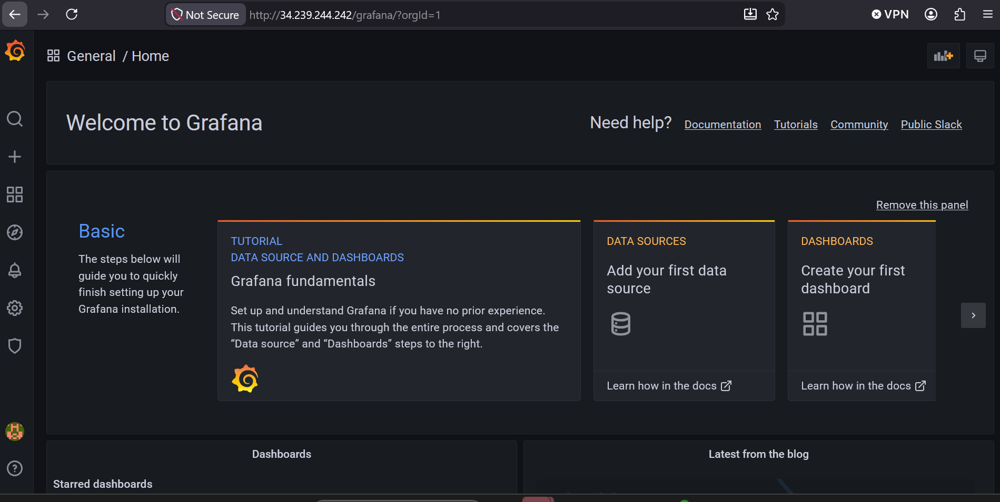

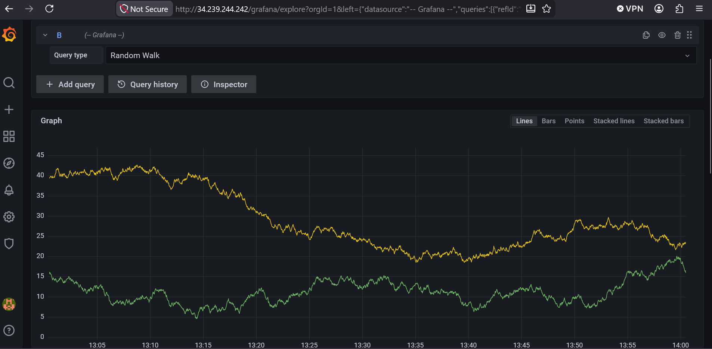

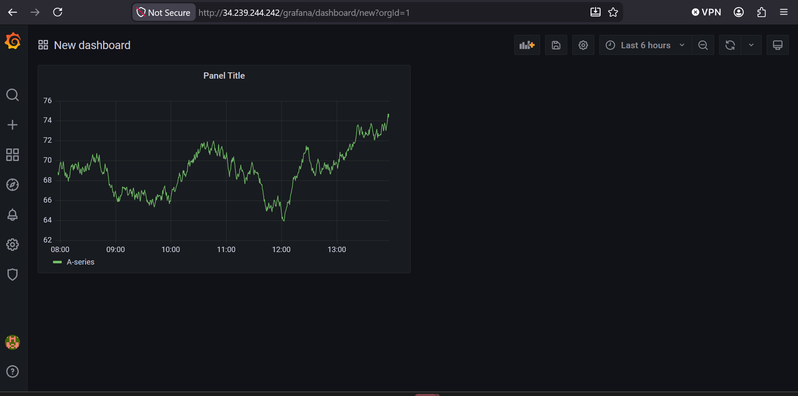

Observability does not change A2A routing or service provisioning. It supplies the evidence needed to understand the workflow: agent requests, MCP activity, A2A handoffs, controller results, failures, and workload health.

## Operating rules

- Configure each agent with a reachable peer `A2A_PEERS` URL.
- Allow peer-to-peer ingress traffic on TCP port 80 between the EC2 security groups.
- Apply the peer value through the active deployment owner: root `.env` plus `deploy-k8s.sh` for a manual deployment, or Helm GitOps values plus an Argo CD sync for an Argo-managed deployment.
- Run only one active Agentic deployment owner in a `tfs-agentic` namespace. A manual stack and an Argo-managed stack both publish `/agentic`, so running both makes traffic and configuration ownership ambiguous.

With those rules in place, the operator gets one natural-language interface while the two TFS controllers keep independent authority over their own network domains.
